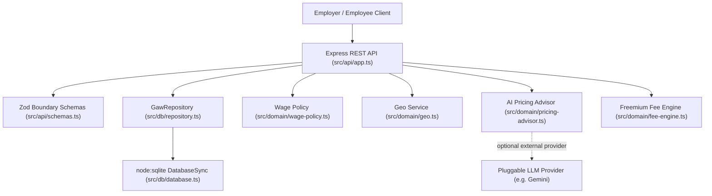
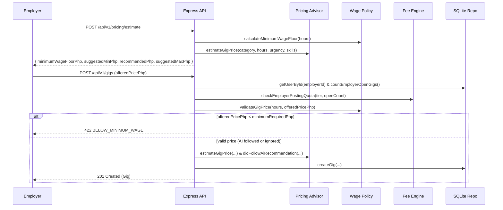
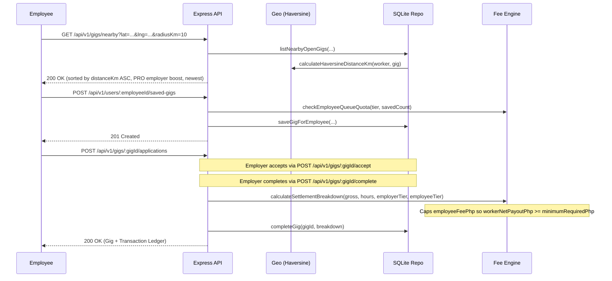
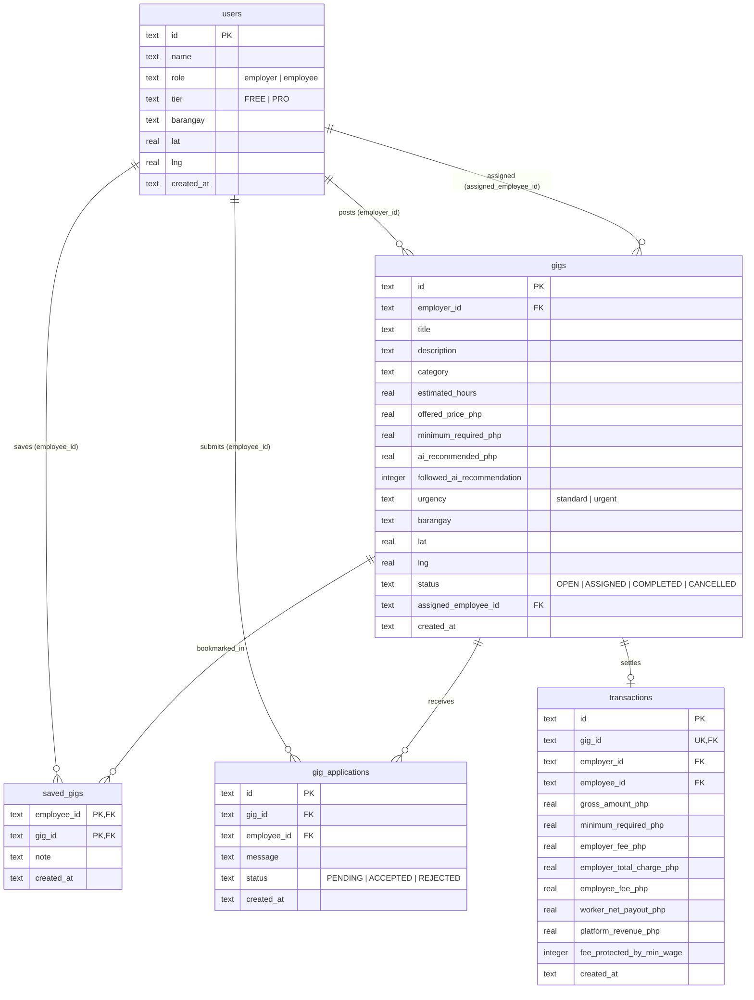

# GAW Backend Architecture

## 1. System Overview

GAW is organized as a modular monolith with strict dependency direction:

`api (HTTP & Zod validation)` → `db (SQLite repository)` & `domain (pure business rules)`

This ensures all business invariants (Davao Region XI minimum wage, Haversine proximity, AI pricing heuristics, and freemium fee protection) are pure, deterministic, and independently verifiable at 100% coverage while the repository boundary cleanly isolates `node:sqlite` (`DatabaseSync`) for future PostgreSQL migration.

## 2. Core Flows

### 2.1 Employer Gig Creation & Optional AI Pricing

### 2.2 Employee Proximity Discovery & Minimum-Wage-Protected Settlement

## 3. Data Model (ERD)

## 4. REST API Contract (`/api/v1`)

| Method & Path | Description | Key Status Codes |
|---|---|---|
| `GET /api/v1/health` | Service health & active Davao Region XI wage config | `200` |
| `POST /api/v1/users` | Register employer or employee inside Davao bounds | `201`, `422` |
| `GET /api/v1/users/:userId` | Retrieve user profile and tier quota metadata | `200`, `404` |
| `PATCH /api/v1/users/:userId/subscription` | Upgrade or downgrade subscription tier (`FREE` / `PRO`) | `200`, `404`, `422` |
| `POST /api/v1/pricing/estimate` | Calculate Davao wage floor & AI/heuristic price band | `200`, `422` |
| `POST /api/v1/gigs` | Create gig enforcing quota & Davao minimum wage floor | `201`, `403`, `404`, `422` |
| `GET /api/v1/gigs/nearby` | Discover open gigs by Haversine distance (`radiusKm`) | `200`, `422` |
| `GET /api/v1/gigs/:gigId` | Retrieve gig details | `200`, `404` |
| `POST /api/v1/users/:employeeId/saved-gigs` | Save gig to employee's desired-gigs queue | `201`, `403`, `404`, `409`, `422` |
| `GET /api/v1/users/:employeeId/saved-gigs` | List employee's desired gigs sorted by proximity | `200`, `404` |
| `DELETE /api/v1/users/:employeeId/saved-gigs/:gigId` | Remove gig from desired-gigs queue | `200`, `404` |
| `POST /api/v1/gigs/:gigId/applications` | Submit employee application for an `OPEN` gig | `201`, `403`, `404`, `409`, `422` |
| `POST /api/v1/gigs/:gigId/accept` | Employer accepts an application (`OPEN` → `ASSIGNED`) | `200`, `403`, `404`, `409`, `422` |
| `POST /api/v1/gigs/:gigId/complete` | Complete gig and record freemium fee settlement | `200`, `403`, `404`, `409`, `422` |
| `GET /api/v1/users/:userId/transactions` | List settlement ledger entries for user | `200`, `404` |
