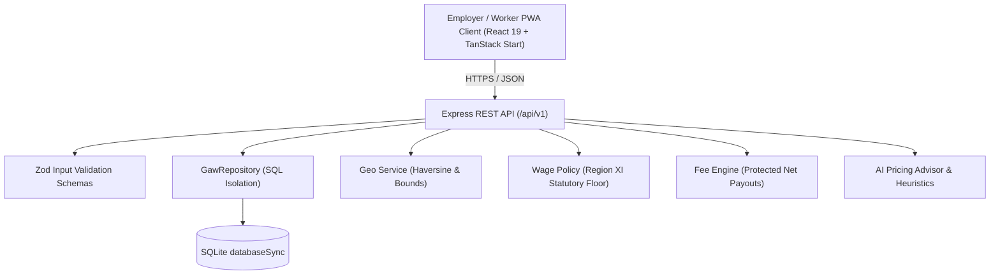
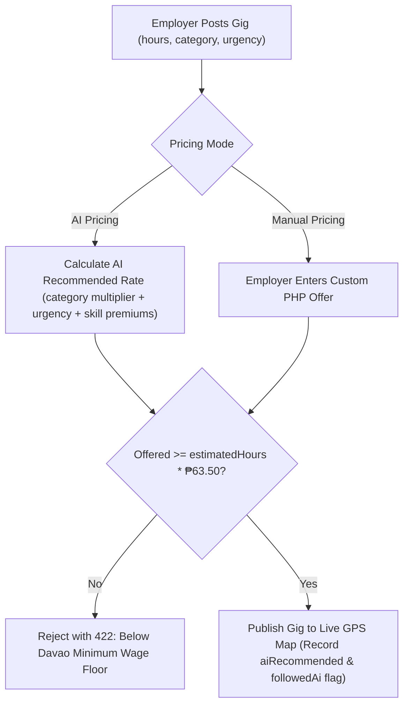
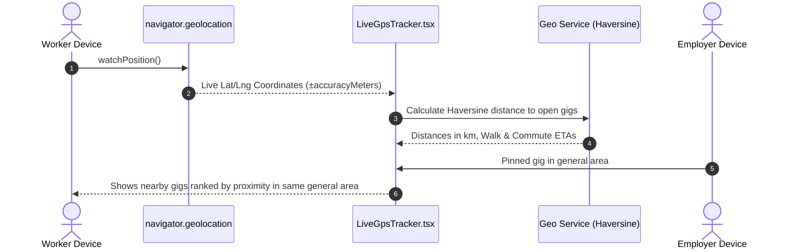

# GAW (Grab a Work) — Platform Technical & Operational Documentation

> **Davao City (Region XI) Hyperlocal Gig & Sidejob Platform**  
> *Connecting local talent and employers through real-time GPS proximity, statutory minimum wage protection, and transparent freemium economics.*

---

## 1. Executive Summary & Vision

**GAW (Grab a Work)** is a mobile-first, full-stack Progressive Web App (PWA) and REST API backend designed specifically for **Davao City, Philippines (Region XI)**. GAW solves the coordination failure between underemployed or unemployed skilled informal workers (plumbers, electricians, appliance technicians, cleaners, painters, mechanics) and local homeowners or business employers who need short-term on-demand help.

### Core Value Drivers
1. **Live GPS Tracking System**: Instead of restricting users to static city hubs or fixed barangay dropdowns, GAW uses real-time continuous GPS tracking (`navigator.geolocation.watchPosition`) and Haversine distance calculations to connect workers and employers in the **same general area**.
2. **Statutory Minimum Wage Protection**: Full compliance with **Davao Region XI Wage Order No. RBXI-23**, enforcing a strict wage floor of **₱508.00/day** (**₱63.50/hour**). Gigs cannot be created below this statutory floor regardless of whether the employer chooses **AI Pricing** or **Manual Pricing**.
3. **Protected Worker Net Payouts**: The platform caps fee deductions so a worker's net take-home earnings are never diluted below the legal minimum wage floor.
4. **100% Free Worker Tools & ₱69/mo Employer Pro Buyout**: Workers never pay subscription fees. Employers can optionally subscribe to **GAW Employer Pro at ₱69/month** to lower their transaction settlement fee from 5% to 2% and post unlimited concurrent gigs.

---

## 2. Architecture & Tech Stack

GAW is structured as a modular monorepo cleanly separating frontend and backend domain boundaries:

### Component Breakdown

| Layer | Technology | Key Modules & Paths |
|---|---|---|
| **Frontend PWA** | React 19, TanStack Start & Router, Tailwind CSS, Vite, Nitro SSR | `pixel-perfect/src/` (`LiveGpsTracker.tsx`, `GawMap.tsx`, `PostGigCard.tsx`, `AppLayout.tsx`) |
| **API Server** | Node.js, Express, TypeScript, Zod | `src/api/app.ts`, `src/api/schemas.ts` |
| **Data Access** | `node:sqlite` (`DatabaseSync`), parameterized queries | `src/db/repository.ts`, `src/db/database.ts`, `src/db/seed.ts` |
| **Domain Logic** | Pure TypeScript (100% test coverage) | `src/domain/wage-policy.ts`, `src/domain/geo.ts`, `src/domain/fee-engine.ts`, `src/domain/pricing-advisor.ts` |
| **Quality Gates** | Vitest, V8 Coverage, Playwright, Shell | `scripts/qg-verify.sh`, `scripts/perf-check.mjs`, `scratch/e2e-verify.mjs` |

---

## 3. Statutory Wage Guard & Pricing Models

### 3.1 Davao Region XI Minimum Wage Rule
- **Statutory Authority**: Wage Order No. RBXI-23.
- **Daily Floor**: **₱508.00** per 8-hour workday.
- **Hourly Minimum Floor**: **₱63.50 / hour** ($\frac{508}{8}$).
- **Minimum Gig Price**: $\text{minimumRequiredPhp} = \text{roundToCents}(\text{estimatedHours} \times 63.50)$.
- **Strict Enforcement**: If an employer submits a gig where $\text{offeredPricePhp} < \text{minimumRequiredPhp}$, the backend immediately rejects the request with HTTP `422 Unprocessable Entity` (`code: "BELOW_MINIMUM_WAGE"`).

### 3.2 Dual Pricing Architecture: AI Pricing vs. Manual Pricing
Employers on GAW are never forced into an opaque algorithm. The gig creation flow on `/hire` ([PostGigCard.tsx](file:///Users/euri/Documents/antigravity/GAW/pixel-perfect/src/components/gaw/PostGigCard.tsx)) provides two transparent pricing modes:

1. **AI Pricing Advisor**:
   - Calculates recommended ranges using category multipliers (e.g. Electrical: 1.4×, Plumbing: 1.35×, Appliance Repair: 1.45×), urgency multipliers (+20% for emergency calls), and required skills (+5% per skill, capped at +25%).
   - Always clamped so that the lower bound is never below the statutory wage floor.
2. **Manual Pricing**:
   - Allows employers to set any custom rate they see fit.
   - Guarded by the real-time client validation and backend check: custom rates below ₱63.50/hr are blocked before publication.

---

## 4. Live GPS Proximity System (General Area Matching)

Prior iterations anchored discovery to eight fixed Davao hub districts. In accordance with user requirements, GAW eliminates arbitrary hub boundaries in favor of a continuous **Live GPS tracking system**:

### Key GPS Features
- **1:1 Web Mercator Street Map**: Real rendered OpenStreetMap tiles (`z12` to `z18`) displaying worker and gig locations.
- **Continuous Tracking**: Auto-syncs live worker movement via `navigator.geolocation.watchPosition` with graceful fallback to manual map pinning when location permissions are denied.
- **Simulation Suite for Testing**: Built-in directional movement (`Step North`, `Step South`, `Step West`, `Step East` $\approx 250\text{ m}$) and automated `Worker Walk Demo` simulating real Davao commutes across major corridors.
- **Live Distance & ETA Badges**: Displays Haversine distance ($\pm 10\text{ m}$), estimated walking minutes ($\sim 5\text{ km/h}$), and motorcycle commute minutes ($\sim 25\text{ km/h}$).

---

## 5. Subscription & Freemium Economics

GAW enforces a sustainable freemium business model with zero fees for workers and a clear value proposition for employers:

| Feature / Dimension | Standard (Free Tier) | Employer Pro Buyout |
|---|---|---|
| **Monthly Subscription Price** | **₱0** | **₱69 / month** |
| **Target User** | Occasional home repairs & errands | Active households, property managers, restaurants, cafés |
| **Max Concurrent Open Gigs** | **3 active gigs** | **Unlimited active gigs** |
| **Platform Settlement Fee** | **5%** added to completed booking | **2%** added to completed booking |
| **Feed Ranking** | Standard distance order | Distance tie-breaker priority boost |
| **Worker Experience** | Always 100% Free | Always 100% Free |

### Worker Fee Protection Equation
When settling a completed gig, GAW calculates:
$$\text{rawEmployeeFee} = \text{grossAmount} \times \text{employeeFeeRate}$$
$$\text{maxDeductibleFee} = \max(0, \text{grossAmount} - \text{minimumRequiredPhp})$$
$$\text{actualEmployeeFee} = \min(\text{rawEmployeeFee}, \text{maxDeductibleFee})$$
$$\text{workerNetPayout} = \text{grossAmount} - \text{actualEmployeeFee}$$

This mathematical constraint ensures that **a worker's net take-home pay is never reduced below the statutory minimum wage floor by platform fees**.

---

## 6. REST API Reference (`/api/v1`)

All endpoints accept and return `application/json`. Errors return standard structure `{ error: { code: string, message: string, details?: unknown } }`.

### 6.1 System & Marketplace
- `GET /api/v1/health`: Returns service status and statutory Davao minimum wage configuration.
- `POST /api/v1/marketplace/seed`: Re-initializes sample Davao users and nearby open gigs.

### 6.2 Users & Subscriptions
- `POST /api/v1/users`: Create employer or worker profile with Davao Region bounds check (`lat ∈ [6.85, 7.60]`, `lng ∈ [125.20, 125.75]`).
- `GET /api/v1/users/:userId`: Fetch user details, role, and subscription tier (`FREE` or `PRO`).
- `PATCH /api/v1/users/:userId/subscription`: Upgrade or downgrade employer membership (e.g. activate Pro for ₱69/mo).

### 6.3 Pricing & Gigs
- `POST /api/v1/pricing/estimate`: Computes statutory minimum wage floor and recommended AI price bands.
- `POST /api/v1/gigs`: Post a new gig with minimum wage validation and optional AI adherence tracking.
- `GET /api/v1/gigs/nearby?lat=...&lng=...&radiusKm=...`: Proximity search sorted by distance, Pro boost, and creation date.
- `GET /api/v1/gigs/:gigId`: Retrieve detailed gig information.

### 6.4 Desired Gigs & Applications
- `POST /api/v1/users/:employeeId/saved-gigs`: Worker saves a gig to personal desired queue.
- `GET /api/v1/users/:employeeId/saved-gigs`: List saved gigs sorted by proximity to worker's current GPS pin.
- `DELETE /api/v1/users/:employeeId/saved-gigs/:gigId`: Remove a gig from saved queue.
- `POST /api/v1/gigs/:gigId/applications`: Worker applies for an open gig.
- `POST /api/v1/gigs/:gigId/accept`: Employer accepts an application.
- `POST /api/v1/gigs/:gigId/complete`: Employer completes the gig, executing fee calculations with minimum wage fee protection.

---

## 7. Quality Assurance & Quality Gates

GAW enforces automated verification gates through `qg-verify.sh`. Code cannot be shipped without meeting strict thresholds:

1. **100% Backend Unit Test Coverage**:
   - `448 / 448` Statements (100%)
   - `182 / 182` Branches (100%)
   - `76 / 76` Functions (100%)
   - `438 / 438` Lines (100%)
2. **Strict API Latency Budgets (150 requests)**:
   - $p50 \le 5\text{ ms}$ (Actual: $\sim 0.14\text{ ms}$)
   - $p95 \le 200\text{ ms}$ (Actual: $\sim 0.31\text{ ms}$)
   - $p99 \le 500\text{ ms}$ (Actual: $\sim 0.65\text{ ms}$)
   - Error Rate $< 1\%$ (Actual: $0.00\%$)
3. **Frontend Tests**:
   - 25/25 unit & component tests passing across routing, theme toggles, GPS tracking, wage validation, and interaction utilities.
4. **Interactive Playwright E2E**:
   - Automated click-through verification covering welcome flow, login, mode selection, `/hire` manual pricing rejection & acceptance, `/gigs` view, `/find` radar map, `/pro` ₱69/mo pricing display, and `/jobs` live GPS tracker.
